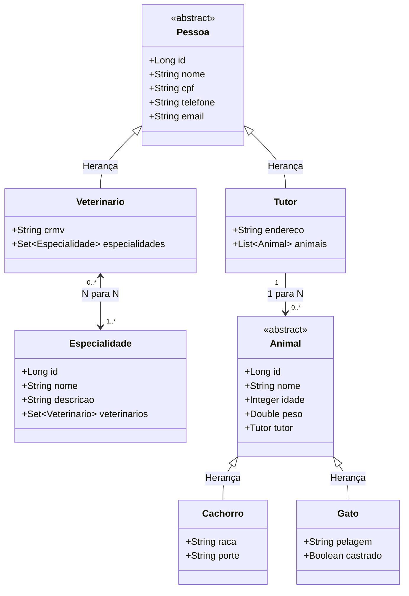

# 🐾 Clínica Veterinária — API REST em Spring Boot

Projeto desenvolvido para a disciplina de desenvolvimento de sistemas utilizando **Java 17**, **Spring Boot 3**, **Hibernate JPA**, **Lombok** e banco de dados relacional **H2**.

---

## 🎯 Cumprimento dos Requisitos da Avaliação

| Requisito do Enunciado | Implementação no Código |
| :--- | :--- |
| **Entidade definida por extensão (Herança)** | `Pessoa` &rarr; `Tutor` e `Veterinario`<br>`Animal` &rarr; `Cachorro` e `Gato` (Estratégia `@Inheritance(strategy = InheritanceType.JOINED)`) |
| **Entidades com cardinalidade 1 para N (1:N)** | `Tutor` (1) possui `Animal` (N) (`@OneToMany` / `@ManyToOne`) |
| **Entidades com cardinalidade N para N (N:N)** | `Veterinario` (N) possui `Especialidade` (N) com tabela associativa `tb_veterinario_especialidade` |
| **CRUD Completo para todas as entidades** | Implementado com métodos `GET`, `POST`, `PUT` e `DELETE` em todos os Controllers |
| **Banco de Dados Relacional** | Banco relacional **H2** em memória com console web ativo |
| **Lombok** | Utilizado para redução de boilerplate (`@Data`, `@SuperBuilder`, `@NoArgsConstructor`, etc.) |

---

## 📐 Diagrama de Classes & Relacionamentos



---

## 🛠️ Tecnologias Utilizadas

- **Java 17** (LTS)
- **Spring Boot 3.1.1**
  - Spring Data JPA (Hibernate 6)
  - Spring Web (Tomcat Embutido)
  - Spring Validation
- **Banco de Dados**: H2 Database (In-Memory)
- **Lombok**: 1.18.36
- **Front-end Integrado**: HTML5, Tailwind CSS, FontAwesome e Fetch API (servido em `src/main/resources/static`)

---

## 💡 Sobre o Banco de Dados H2 (Execução Plug & Play)

Para garantir que o avaliador/professor consiga **executar o projeto imediatamente apenas abrindo o código e clicando em Play**, optamos por configurar o **H2 Database** em conjunto com o **Hibernate (JPA)**:

- **100% Relacional (SQL ANSI)**: O H2 é um Sistema de Gerenciamento de Banco de Dados Relacional completo. Ele respeita chaves primárias, chaves estrangeiras, `JOINs`, constraints de unicidade e integridade referencial.
- **Zero Configuração / Dependência Externa**: Não é necessário ter PostgreSQL, MySQL ou Docker instalados na máquina do avaliador. A aplicação sobe de forma autônoma e imediata.
- **Agnóstico de Banco (Padrão de Mercado)**: Como toda a persistência foi desenvolvida com abstração de alto nível no **Hibernate / Spring Data JPA**, a aplicação é totalmente agnóstica de banco: para migrar para PostgreSQL ou Oracle em produção, basta alterar as credenciais no `application.properties`, sem alterar nenhuma linha de código Java.
- **Carga Automática de Dados (`DataInitializer`)**: Ao iniciar a aplicação, um script embutido já popula o banco com dados de teste consistentes para demonstração imediata de todos os relacionamentos e heranças.
- **Console Web Integrado**: O projeto disponibiliza o painel visual do banco em `http://localhost:8085/h2-console`.

---

## 🚀 Como Executar o Projeto

### Pré-requisitos
- JDK 17 instalado e configurado nas variáveis de ambiente.

### Opção 1: Pelo Terminal / Prompt de Comando
```bash
# Clone o repositório
git clone https://github.com/SEU-USUARIO/clinica-veterinaria.git
cd clinica-veterinaria

# Execute o script direto (Windows)
.\run.bat

# Ou via JAR:
java -jar target/clinica-veterinaria-0.0.1-SNAPSHOT.jar
```

### Opção 2: Pelo IntelliJ IDEA
1. Abra o IntelliJ e selecione a pasta do projeto.
2. Certifique-se de que o SDK do projeto está definido como **Java 17** em `File > Project Structure > Project`.
3. Abra a classe `ClinicaVeterinariaApplication.java` e clique no botão **Play (▶️)**.

---

## 🌐 Endpoints da API REST

A aplicação roda por padrão na porta **8085** (evitando conflitos com a porta 8080):

### 1. Tutores (`/api/tutores`)
- `GET /api/tutores` — Listar todos os tutores (com seus animais associados)
- `GET /api/tutores/{id}` — Buscar tutor por ID
- `POST /api/tutores` — Cadastrar novo tutor
- `PUT /api/tutores/{id}` — Atualizar tutor
- `DELETE /api/tutores/{id}` — Excluir tutor

### 2. Veterinários (`/api/veterinarios`)
- `GET /api/veterinarios` — Listar todos os veterinários (com especialidades)
- `GET /api/veterinarios/{id}` — Buscar veterinário por ID
- `POST /api/veterinarios` — Cadastrar novo veterinário
- `PUT /api/veterinarios/{id}` — Atualizar veterinário
- `POST /api/veterinarios/{id}/especialidades/{especialidadeId}` — Associar especialidade (N:N)
- `DELETE /api/veterinarios/{id}/especialidades/{especialidadeId}` — Desassociar especialidade
- `DELETE /api/veterinarios/{id}` — Excluir veterinário

### 3. Especialidades (`/api/especialidades`)
- `GET /api/especialidades` — Listar especialidades
- `GET /api/especialidades/{id}` — Buscar especialidade por ID
- `POST /api/especialidades` — Cadastrar especialidade
- `PUT /api/especialidades/{id}` — Atualizar especialidade
- `DELETE /api/especialidades/{id}` — Excluir especialidade

### 4. Cachorros e Gatos (Herança de Animal)
- `GET /api/cachorros` | `GET /api/gatos` — Listar animais
- `POST /api/cachorros?tutorId={id}` — Cadastrar cachorro vinculado ao tutor (1:N)
- `POST /api/gatos?tutorId={id}` — Cadastrar gato vinculado ao tutor (1:N)
- `PUT /api/cachorros/{id}` | `PUT /api/gatos/{id}` — Atualizar dados do animal
- `DELETE /api/cachorros/{id}` | `DELETE /api/gatos/{id}` — Excluir animal

---

## 🗄️ Acesso ao Console do Banco de Dados (H2 Console)

- **URL no navegador**: `http://localhost:8085/h2-console`
- **JDBC URL**: `jdbc:h2:mem:veterinariadb`
- **User Name**: `sa`
- **Password**: *(em branco)*

---

